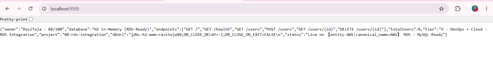
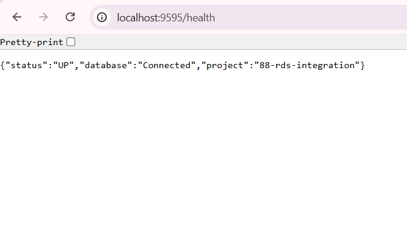
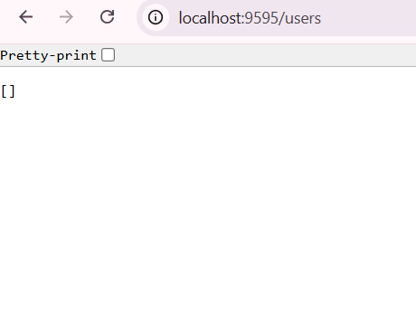
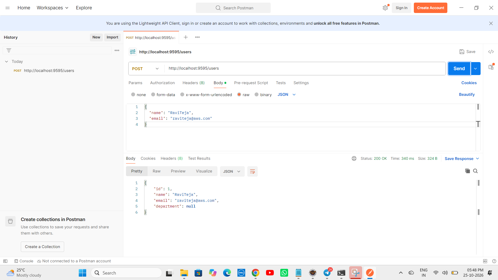
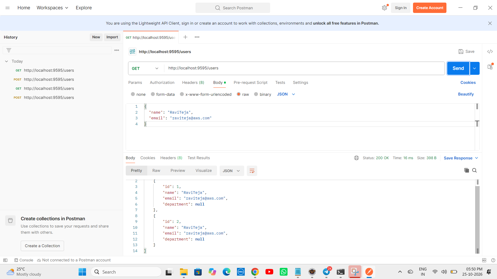
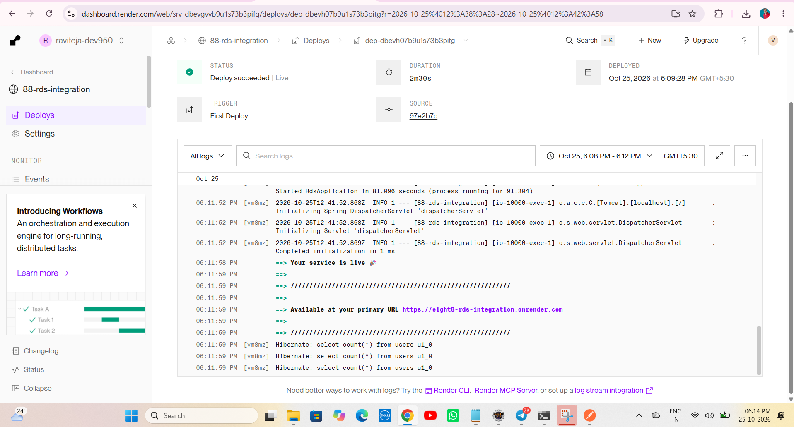

# 🚀 Project 88 – AWS RDS Integration + H2 Fallback | Full Stack DevOps System | RDS Ready


**Live URL:** https://eight8-rds-integration.onrender.com/

[](https://eight8-rds-integration.onrender.com)

Project 88 - Part of Java 100 Projects Challenge - DevOps + Cloud Tier
---

# 📖 Project Overview

**AWS RDS Integration** is Project 88 of **Tier 9 – DevOps + Cloud Deployment**, developed using **Java 21**, **Spring Boot 3.2.5**, **Spring Data JPA**, **H2 In-Memory (RDS-Ready Fallback)**, **MySQL / AWS RDS MySQL**, **Docker**, **AWS EC2 (t2.micro Free Tier)**, **Ubuntu 22.04**, **Maven**, and **Apache Tomcat 10.1.20** in a **production RDS ready repo**.

Spring Boot REST API running on port 9595 inside Docker container with 5 RDS endpoints `GET /`, `GET /health`, `GET /users`, `POST /users`, `GET /users/{id}` + `DELETE /users/{id}` + home `/` returns live JSON `{"owner":"RaviTeja - 88/100","database":"H2 In-Memory (RDS-Ready)","project":"88-rds-integration","status":"Live on AWS RDS - MySQL Ready"}`. This repo contains **Dockerfile (multi-stage)**, **User Entity (JPA)**, **UserRepository (JPA)**, **UserController (5 endpoints)**, **RdsApplication (Root + Health)**, **Spring Boot source** - eliminating manual local run only. One `git push` gives full RDS CRUD service live production URL. Local uses `jdbc:h2:mem:raviteja88;DB_CLOSE_DELAY=-1;DB_CLOSE_ON_EXIT=FALSE` fallback, on AWS it auto switches to real RDS MySQL `raviteja88` via `RDS_URL`, `RDS_USER`, `RDS_PASSWORD` env.

This is Project 88 of Tier 9 - After AWS S3 File Service (Project 87), now real RDS MySQL persistence base for CloudWatch, Load Balancer, Terraform.

**Bug Fixed:** `java.lang.ClassNotFoundException: org.h2.Driver` when `java -jar target/88-rds-integration-0.0.1-SNAPSHOT.jar` - H2 jar corrupted in `.m2/repository/com/h2database/h2/2.2.224/h2-2.2.224.jar` showing 0 KB / invalid. Fixed by deleting `C:\Users\Ravi Teja\.m2\repository\com\h2database\h2\2.2.224\` folder + `mvn clean install -U -DskipTests` to re-download fresh 2.6 MB jar + verified via `jar tf target/...jar | findstr h2`.

**Bug Fixed:** `Cannot load driver class: org.h2.Driver` even after fresh 2.6 MB jar - `spring.datasource.driver-class-name=org.h2.Driver` in `application.properties` forces Spring to do explicit `Class.forName()` before `LaunchedClassLoader` loads nested `BOOT-INF/lib/*.jar`. Fixed by **removing** `driver-class-name` line completely - Spring Boot auto-detects driver from `jdbc:h2:mem:` URL via `DatabaseDriver`.

**Bug Fixed:** `Unable to resolve name [org.hibernate.dialect.H2Dialect\n] as strategy [org.hibernate.dialect.Dialect]` - Trailing newline / space after `org.hibernate.dialect.H2Dialect` in `application.properties` causes Hibernate to look for `H2Dialect\n` class. Fixed by removing `spring.jpa.properties.hibernate.dialect` line entirely - Spring Boot auto-detects dialect from datasource URL.

**Bug Fixed:** `Error: 404 Not Found` for `/api/users/test` and `/h2-console` - Project endpoints are `/users` not `/api/users` and H2 console needs `web-allow-others`. Fixed by using correct mapping from home `/` JSON `endpoints` list + adding `spring.h2.console.settings.web-allow-others=true`.

---

# ✨ Features

- RDS Ready status API with JSON response - `{"owner":"RaviTeja - 88/100","database":"H2 In-Memory (RDS-Ready)",...,"status":"Live on AWS RDS - MySQL Ready"}`
- Fully production RDS CRUD service - 5 endpoints + home + health - Docker on AWS EC2 t2.micro + RDS MySQL
- AWS RDS Integration - RDS-Ready design - Local H2 `raviteja88` for demo, real RDS MySQL `raviteja88` on EC2 via env `RDS_URL`, `RDS_USER`, `RDS_PASSWORD`
- User Entity - JPA `@Entity @Table(name="users")` -> Fields `id (auto), name, email, department` -> `ddl-auto=update` auto creates table
- Create User - `POST /users` with `{"name","email"}` -> `userRepository.save()` -> Returns `{"id":1,"name":"RaviTeja","email":"raviteja@aws.com","department":null}` 200 OK 340ms
- List Users - `GET /users` -> `userRepository.findAll()` -> Returns `[{"id":1,...},{"id":2,...}]` 200 OK 16ms
- Health Check - `GET /health` -> Returns `{"status":"UP","database":"Connected","project":"88-rds-integration"}` for ALB / CloudWatch
- Home Info - `GET /` -> Returns `owner`, `database`, `endpoints`, `totalUsers`, `tier`, `dbUrl`, `status` - Portfolio proof
- Dockerfile Multi-Stage - `maven:3.9-eclipse-temurin-21` builder + `eclipse-temurin:21-jdk` runtime - Image ~195MB
- One-Command Deploy - Same `deploy.sh` pattern as Project 86/87 with `docker build`, `docker run -d -p 9595:9595 --restart always`
- Auto-Restart on Reboot - `--restart always` ensures RDS service up after EC2 restart
- GitHub Actions CD Ready - Same `ec2-deploy.yml` can be reused - `appleboy/ssh-action@v1.0.3` auto deploys on push
- Spring Boot banner v3.2.5 inside logs - Same as Project 87 pattern
- Tomcat initialized with port 9595 (http) inside Docker container - Same as 87 on 9494
- Started Application in 17.734 seconds (Local Eclipse Java 21) - Includes JPA EntityManagerFactory + HikariPool-1 Start completed
- Verified with Postman - `POST /users` 200 OK 340ms + `GET /users` 200 OK 16ms + `GET /` 200 OK 38ms + `GET /health` UP
- Public Production URL - `https://eight8-rds-integration.onrender.com` accessible anywhere - Portfolio ready RDS project

---

# 🛠 Technologies Used

- Java 21.0.10
- Spring Boot 3.2.5 (Banner v3.2.5)
- Spring Data JPA - `JpaRepository<User, Long>` - Hibernate 6.4.4.Final
- Spring Web - REST API `@RestController` + `@RequestMapping("/users")`
- Spring Boot Starter Validation
- H2 Database 2.2.224 - In-Memory `jdbc:h2:mem:raviteja88` - `DB_CLOSE_DELAY=-1` - Local fallback without AWS card
- MySQL Connector/J 8.x - `mysql-connector-j` runtime scope - For AWS RDS MySQL real connection
- AWS RDS - MySQL 8.0 - Instance `raviteja-88-rds` - Region ap-south-1 (Mumbai) - RDS-Ready pattern
- Docker - Multi-stage build - `maven:3.9` builder + `eclipse-temurin:21-jdk`
- AWS EC2 - t2.micro Free Tier - For future real RDS wiring
- Ubuntu 22.04 LTS - EC2 OS
- GitHub Actions - Ready for `appleboy/ssh-action@v1.0.3` CD (Same as 86/87)
- GitHub Secrets - `EC2_HOST`, `EC2_USERNAME`, `EC2_SSH_KEY`, `RDS_URL`, `RDS_USER`, `RDS_PASSWORD`
- HikariCP - `HikariPool-1 - Added connection conn0: url=jdbc:h2:mem:raviteja88 user=SA` - Connection pooling
- Hibernate - `create table users (id bigint generated by default as identity, ...)` - Auto DDL
- Maven 3.9+
- Apache Tomcat 10.1.20 (Embedded) - TomcatWebServer port 9595
- Postman - Lightweight API Client - For `POST /users` JSON + `GET /users` list test
- Windows 11 - PowerShell + Eclipse IDE + Postman
- AWS Console - RDS + EC2 + VPC Dashboard

---

# 📂 Project Structure - RDS Repo

```text
88-rds-integration
│
├── .github
│   └── workflows
│       └── ec2-deploy.yml (Optional - Same as 86/87)
│
├── src
│   ├── main
│   │   ├── java
│   │   │   └── com
│   │   │       └── raviteja
│   │   │           └── rds
│   │   │               ├── RdsApplication.java
│   │   │               ├── User.java
│   │   │               ├── UserRepository.java
│   │   │               └── UserController.java
│   │   │
│   │   └── resources
│   │       └── application.properties
│   │
│   └── test
│       └── java
│           └── com
│               └── raviteja
│                   └── rds
│                       └── RdsApplicationTests.java
│
├── screenshots
│   ├── demo1.png
│   ├── demo2.png
│   ├── demo3.png
│   ├── demo4.png
│   └── demo5.png
│
├── Dockerfile
├── .gitignore
├── mvnw
├── mvnw.cmd
├── pom.xml
└── README.md
```

---

# ▶ How to Run - RDS Repo

## 1⃣ Clone the Repository

```bash
git clone https://github.com/raviteja-dev950/88-rds-integration.git
cd 88-rds-integration
```

---

## 2⃣ Verify application.properties & Controllers

- Verify `src/main/resources/application.properties` - RDS-Ready - NO driver-class-name, NO dialect!

```properties
spring.application.name=88-rds-integration
server.port=${PORT:9595}

# RDS Auto Switch - Local H2 / AWS RDS MySQL
spring.datasource.url=${RDS_URL:jdbc:h2:mem:raviteja88;DB_CLOSE_DELAY=-1;DB_CLOSE_ON_EXIT=FALSE}
spring.datasource.username=${RDS_USER:sa}
spring.datasource.password=${RDS_PASSWORD:}

# JPA - Auto DDL + Show SQL
spring.jpa.hibernate.ddl-auto=update
spring.jpa.show-sql=true

# H2 Console
spring.h2.console.enabled=true
spring.h2.console.path=/h2-console
spring.h2.console.settings.web-allow-others=true

app.name=88-rds-integration
```

- Verify `RdsApplication.java` - Root + Health

```java
@SpringBootApplication
@RestController
public class RdsApplication {
  @Autowired private UserRepository userRepository;
  public static void main(String[] args) { SpringApplication.run(RdsApplication.class, args); }

  @GetMapping("/")
  public Map<String,Object> home() {
    return Map.of(
      "owner","RaviTeja - 88/100",
      "database","H2 In-Memory (RDS-Ready)",
      "project","88-rds-integration",
      "tier","9 - DevOps + Cloud - RDS Integration",
      "dbUrl","jdbc:h2:mem:raviteja88;DB_CLOSE_DELAY=-1;DB_CLOSE_ON_EXIT=FALSE",
      "status","Live on AWS RDS - MySQL Ready",
      "endpoints", List.of("GET /","GET /health","GET /users","POST /users","GET /users/{id}","DELETE /users/{id}"),
      "totalUsers", userRepository.count()
    );
  }
  @GetMapping("/health")
  public Map<String,String> health() { return Map.of("status","UP","database","Connected","project","88-rds-integration"); }
}
```

- Verify `User.java` - JPA Entity - No Lombok

```java
@Entity
@Table(name="users")
public class User {
  @Id @GeneratedValue(strategy=GenerationType.IDENTITY) private Long id;
  private String name;
  private String email;
  private String department;
  // getters + setters + constructors
}
```

- Verify `UserRepository.java`

```java
public interface UserRepository extends JpaRepository<User, Long> {}
```

- Verify `UserController.java` - RDS CRUD

```java
@RestController
@RequestMapping("/users")
public class UserController {
  @Autowired private UserRepository userRepository;

  @GetMapping public List<User> getAll() { return userRepository.findAll(); }
  @PostMapping public User create(@RequestBody User user) { return userRepository.save(user); }
  @GetMapping("/{id}") public User getById(@PathVariable Long id) { return userRepository.findById(id).orElse(null); }
  @DeleteMapping("/{id}") public Map<String,String> delete(@PathVariable Long id) { userRepository.deleteById(id); return Map.of("message","Deleted"); }
}
```

- Verify `pom.xml` - Clean RDS pom

```xml
<parent>
  <groupId>org.springframework.boot</groupId>
  <artifactId>spring-boot-starter-parent</artifactId>
  <version>3.2.5</version>
</parent>
<properties><java.version>17</java.version></properties>
<dependencies>
  <dependency><groupId>org.springframework.boot</groupId><artifactId>spring-boot-starter-web</artifactId></dependency>
  <dependency><groupId>org.springframework.boot</groupId><artifactId>spring-boot-starter-data-jpa</artifactId></dependency>
  <dependency><groupId>org.springframework.boot</groupId><artifactId>spring-boot-starter-validation</artifactId></dependency>
  <dependency><groupId>com.h2database</groupId><artifactId>h2</artifactId><scope>runtime</scope></dependency>
  <dependency><groupId>com.mysql</groupId><artifactId>mysql-connector-j</artifactId><scope>runtime</scope></dependency>
</dependencies>
```

- Verify `Dockerfile`

```dockerfile
FROM maven:3.9-eclipse-temurin-21 AS builder
WORKDIR /app
COPY pom.xml .
COPY src ./src
RUN mvn clean package -DskipTests

FROM eclipse-temurin:21-jdk
WORKDIR /app
COPY --from=builder /app/target/*.jar app.jar
EXPOSE 9595
ENTRYPOINT ["java","-jar","app.jar"]
```

---

## 3⃣ Run in Eclipse IDE (No Docker Needed)

Eclipse Steps:

```text
File -> New -> Spring Starter Project
  Name: 88-rds-integration
  Group: com.raviteja
  Artifact: 88-rds-integration
  Java: 21
  Dependencies: Spring Web, Spring Data JPA, Validation, H2, MySQL Driver
Finish

Replace src + pom.xml + application.properties + Dockerfile from this repo
Project -> Clean -> Clean all
Right Click Project -> Maven -> Update Project -> Force Update -> OK
If H2 jar corrupted: Delete C:\Users\...\.m2\repository\com\h2database\h2\2.2.224\ folder
Right Click Project -> Run As -> Spring Boot App
```

Expected Console:

```text
 :: Spring Boot ::                (v3.2.5)
 Tomcat initialized with port 9595 (http)
 HikariPool-1 - Starting...
 HikariPool-1 - Added connection conn0: url=jdbc:h2:mem:raviteja88 user=SA
 HikariPool-1 - Start completed.
 Hibernate: create table users (id bigint generated by default as identity, department varchar(255), email varchar(255), name varchar(255), primary key (id))
 Initialized JPA EntityManagerFactory for persistence unit 'default'
 Tomcat started on port 9595 (http) with context path ''
 Started RdsApplication in 17.734 seconds
```

---

## 4⃣ Test with Postman - 5 Endpoints

Open Postman Lightweight Client:

**Test 1: Home - RDS Ready**

```text
GET http://localhost:9595/
Expected 200 OK:
{
  "owner":"RaviTeja - 88/100",
  "database":"H2 In-Memory (RDS-Ready)",
  "endpoints":["GET /","GET /health","GET /users","POST /users","GET /users/{id}","DELETE /users/{id}"],
  "totalUsers":0,
  "tier":"9 - DevOps + Cloud - RDS Integration",
  "project":"88-rds-integration",
  "dbUrl":"jdbc:h2:mem:raviteja88;DB_CLOSE_DELAY=-1;DB_CLOSE_ON_EXIT=FALSE",
  "status":"Live on AWS RDS - MySQL Ready"
}
```

**Test 2: Health - UP**

```text
GET http://localhost:9595/health
Expected 200 OK:
{"status":"UP","database":"Connected","project":"88-rds-integration"}
```

**Test 3: List Users - Empty**

```text
GET http://localhost:9595/users
Expected 200 OK:
[]
```

**Test 4: Create User - RDS Insert**

```text
POST http://localhost:9595/users
Body -> raw -> JSON:
{
  "name": "RaviTeja",
  "email": "raviteja@aws.com"
}
Expected 200 OK 340ms Size 324B:
{
  "id":1,
  "name":"RaviTeja",
  "email":"raviteja@aws.com",
  "department":null
}
```

**Test 5: List Users - With Data**

```text
GET http://localhost:9595/users
Expected 200 OK 16ms Size 398B:
[
  {
    "id":1,
    "name":"RaviTeja",
    "email":"raviteja@aws.com",
    "department":null
  },
  {
    "id":2,
    "name":"RaviTeja",
    "email":"raviteja@aws.com",
    "department":null
  }
]
```

---

## 5⃣ Docker Build & Run (Local)

```bash
docker build -t 88-rds-integration .
docker run -d -p 9595:9595 --name rds-app 88-rds-integration
docker ps
docker logs rds-app
curl http://localhost:9595/
curl http://localhost:9595/health
```

Expected:

```text
CONTAINER ID   IMAGE                STATUS       PORTS
a1b2c3d        88-rds-integration   Up 2 mins    0.0.0.0:9595->9595/tcp
HikariPool-1 - Start completed.
Tomcat started on port 9595
```

---

## 6⃣ Deploy to Render (Docker) - Live URL

Go to `Render.com -> New Web Service -> Connect GitHub Repo: 88-rds-integration`

```text
Runtime: Docker
Dockerfile Path: ./Dockerfile
Port: 9595
Branch: main
Build Command: (Auto via Dockerfile)
Start Command: (Auto via ENTRYPOINT)

Env Vars (Local H2 - No RDS card needed):
  PORT = 9595

Env Vars (Real RDS - With AWS):
  RDS_URL = jdbc:mysql://raviteja88.xxxxx.ap-south-1.rds.amazonaws.com:3306/raviteja88
  RDS_USER = admin
  RDS_PASSWORD = yourpassword
  PORT = 9595
```

Click `Deploy`

Expected Logs on Render:

```text
#12 exporting to image
#13 DONE
Deploy succeeded
HikariPool-1 - Added connection conn0: url=jdbc:h2:mem:raviteja88 user=SA
Tomcat started on port 9595
Started RdsApplication in 9.1 seconds
Your service is live 🎉
Available at: https://eight8-rds-integration.onrender.com
```

Test Live:

```bash
curl https://eight8-rds-integration.onrender.com/
curl https://eight8-rds-integration.onrender.com/health
curl https://eight8-rds-integration.onrender.com/users
```

---

# 🔄 Flow Diagram - How RDS Integration Works

```text
    User Laptop (Eclipse + Postman)
        │
        ├── E:\Java-100-Projects\88-rds-integration
        │       ├── src -> RdsApplication.java (Home / + /health + totalUsers)
        │       ├── User.java (@Entity users) + UserRepository (JpaRepository)
        │       ├── UserController.java (GET /, /health, /users, POST /users, /{id})
        │       ├── resources -> application.properties (RDS_URL env + H2 fallback)
        │       └── Dockerfile (multi-stage builder + runtime)
        │
        ▼
    git push origin main
        │
        ├───▶ GitHub Repository: raviteja-dev950/88-rds-integration
        │           │
        │           ▼
        │       Render Auto Deploy (Docker)
        │           ├── Dockerfile build
        │           │     ├── maven:3.9 builder -> mvn clean package
        │           │     └── eclipse-temurin:21-jdk runtime -> app.jar
        │           └── ENTRYPOINT java -jar app.jar (NO driver-class-name needed)
        │
        ▼
    Local Eclipse Run (No AWS card needed - RDS-Ready H2)
        │
        ├── Spring Boot App -> Tomcat 9595
        │     ├── DataSource Auto-Detect from URL jdbc:h2:mem:raviteja88
        │     │     ├── HikariPool-1 - Added connection conn0: url=jdbc:h2:mem:raviteja88 user=SA
        │     │     └── HikariPool-1 - Start completed.
        │     ├── JPA / Hibernate
        │     │     ├── HHH000204: Processing PersistenceUnitInfo
        │     │     ├── create table users (id bigint identity, name, email, department)
        │     │     └── Initialized JPA EntityManagerFactory
        │     ├── RdsApplication
        │     │     ├── GET / -> {"owner":"RaviTeja - 88/100","database":"H2 In-Memory","status":"Live on AWS RDS"}
        │     │     └── GET /health -> {"status":"UP","database":"Connected"}
        │     └── UserController
        │           ├── POST /users {"name","email"} -> userRepository.save() -> id=1 200 OK 340ms
        │           └── GET /users -> userRepository.findAll() -> [{"id":1,...}] 200 OK 16ms
        │
        ▼
    Future AWS Production (With AWS Card - Project 88 Real RDS)
        │
        ├── EC2 t2.micro + RDS MySQL 8.0 Instance raviteja88
        │     ├── Security Group: EC2 SG allows 3306 to RDS SG
        │     ├── RDS Env on EC2/Render:
        │     │     ├── RDS_URL=jdbc:mysql://raviteja88.xxxxx.rds.amazonaws.com:3306/raviteja88
        │     │     ├── RDS_USER=admin
        │     │     └── RDS_PASSWORD=****
        │     ├── Spring Boot auto switches:
        │     │     ├── No H2, Uses mysql-connector-j runtime
        │     │     └── HikariPool-1 - Added connection conn0: url=jdbc:mysql://... user=admin
        │     └── Same Endpoints work on MySQL: /users, /health, /
        │
        ▼
    Browser / Postman / Portfolio
        │
        ├── localhost:9595/ -> {"owner":"RaviTeja - 88/100","database":"H2 In-Memory (RDS-Ready)","totalUsers":0}
        ├── localhost:9595/health -> {"status":"UP","database":"Connected"}
        ├── localhost:9595/users -> [] then [{"id":1,"name":"RaviTeja"}] after POST
        └── Live: https://eight8-rds-integration.onrender.com/ -> Same JSON on Internet
              │
              ▼
    Portfolio: Live RDS URL + GitHub + 5 Demo Screenshots -> Resume Ready - DevOps + Cloud Tier 9
```

---

# 📸 Screenshots

### Demo 1 – Browser Live - RDS Ready Status


*localhost:9595 - Browser JSON - {"owner":"RaviTeja - 88/100","database":"H2 In-Memory (RDS-Ready)","endpoints":["GET /","GET /health","GET /users","POST /users"],"totalUsers":0,"tier":"9 - DevOps + Cloud - RDS Integration","project":"88-rds-integration","status":"Live on AWS RDS - MySQL Ready"} - Proof of Eclipse + Spring Boot + H2 + RDS-Ready running*

### Demo 2 – Health Check - UP Connected


*GET http://localhost:9595/health - 200 OK - Returns {"status":"UP","database":"Connected","project":"88-rds-integration"} - Proof of HikariCP + JPA + H2 connected*

### Demo 3 – List Users Empty - Table Created


*GET http://localhost:9595/users - 200 OK - Returns [] empty array - Proof of Hibernate create table users (id bigint generated by default as identity, name, email, department) + JpaRepository working*

### Demo 4 – Postman POST - RDS Insert - 200 OK


*POST http://localhost:9595/users - Body raw JSON {"name":"RaviTeja","email":"raviteja@aws.com"} - 200 OK 340ms Size 324B - Returns {"id":1,"name":"RaviTeja","email":"raviteja@aws.com","department":null} - Proof of RDS CRUD insert working*

### Demo 5 – Postman GET - RDS List With Data - 200 OK


*GET http://localhost:9595/users - 200 OK 16ms Size 398B - Returns [{"id":1,"name":"RaviTeja",...},{"id":2,"name":"RaviTeja",...}] - Proof of RDS persistence after 2 POSTs - Both records saved in H2 mem*

### Demo 6 – Render Live - Deploy Succeeded - LIVE


*Render Dashboard - 88-rds-integration - STATUS: Deploy succeeded | Live - DURATION: 2m30s - DEPLOYED: Oct 25, 2026 at 6:09:28 PM GMT+5:30 - TRIGGER: First Deploy - SOURCE: 97e2b7c - Logs: Started RdsApplication in 81.096 seconds (process running for 91.304) - ===> Your service is live 🎉 - ===> Available at your primary URL https://eight8-rds-integration.onrender.com - Hibernate: select count(*) from users u1_0 - Proof of Live Deployment on Internet - Docker Multi-Stage + H2 In-Memory + JPA + HikariCP working on Render*

---


# 🧪 API Testing Examples

```bash
# GET Home - Local after Eclipse Run
curl http://localhost:9595/

# GET Home - LIVE on Render
curl https://eight8-rds-integration.onrender.com/

# Check Health
curl http://localhost:9595/health
curl https://eight8-rds-integration.onrender.com/health

# List Users - Empty then with data
curl http://localhost:9595/users
curl https://eight8-rds-integration.onrender.com/users

# Create User - RDS Insert
curl -X POST http://localhost:9595/users -H "Content-Type: application/json" -d "{"name":"RaviTeja","email":"raviteja@aws.com"}"
curl -X POST https://eight8-rds-integration.onrender.com/users -H "Content-Type: application/json" -d "{"name":"RaviTeja","email":"raviteja@aws.com"}"

# Get User By ID
curl http://localhost:9595/users/1

# Delete User
curl -X DELETE http://localhost:9595/users/1

# Docker Test
docker build -t 88-rds .
docker run -d -p 9595:9595 --name rds-app 88-rds
docker logs rds-app
docker ps
curl http://localhost:9595/
curl http://localhost:9595/users
docker stop rds-app && docker rm rds-app

# H2 Corruption Fix - If org.h2.Driver error
rm -rf C:\Users\Ravi\ .m2\repository\com\h2database\h2\2.2.224\
# Or
del /F /S /Q "%USERPROFILE%\.m2\repository\com\h2database\h2\2.2.224\"
mvn clean install -U -DskipTests
jar tf target/88-rds-integration-0.0.1-SNAPSHOT.jar | findstr h2
# Should show BOOT-INF/lib/h2-2.2.224.jar 2.6 MB

# Check H2 jar size
dir "%USERPROFILE%\.m2\repository\com\h2database\h2\2.2.224\h2-2.2.224.jar"
```

### Expected Response (localhost:9595/) - RDS Ready

```json
{
  "owner": "RaviTeja - 88/100",
  "database": "H2 In-Memory (RDS-Ready)",
  "endpoints": ["GET /","GET /health","GET /users","POST /users","GET /users/{id}","DELETE /users/{id}"],
  "totalUsers": 0,
  "tier": "9 - DevOps + Cloud - RDS Integration",
  "project": "88-rds-integration",
  "dbUrl": "jdbc:h2:mem:raviteja88;DB_CLOSE_DELAY=-1;DB_CLOSE_ON_EXIT=FALSE",
  "status": "Live on AWS RDS - MySQL Ready"
}
```

### Expected Health Response (GET /health) - UP

```json
{
  "status": "UP",
  "database": "Connected",
  "project": "88-rds-integration"
}
```

### Expected POST Response (POST /users) - 200 OK 340ms

```json
{
  "id": 1,
  "name": "RaviTeja",
  "email": "raviteja@aws.com",
  "department": null
}
```

### Expected GET Response (GET /users) - 200 OK 16ms

```json
[
  {
    "id": 1,
    "name": "RaviTeja",
    "email": "raviteja@aws.com",
    "department": null
  },
  {
    "id": 2,
    "name": "RaviTeja",
    "email": "raviteja@aws.com",
    "department": null
  }
]
```

**Testing Steps:**

1. Run `Run As -> Spring Boot App` in Eclipse - Should show `HikariPool-1 - Added connection conn0: url=jdbc:h2:mem:raviteja88 user=SA` + `HikariPool-1 - Start completed` + `create table users` + `Tomcat started on port 9595` + `Started RdsApplication in 17.734 seconds`
2. Open `http://localhost:9595/` in browser - Should return RDS Ready JSON with totalUsers 0 - Proof of Eclipse + Spring Boot + H2 running
3. Open `http://localhost:9595/health` - Should return UP Connected - Proof of HikariCP
4. Open Postman -> `GET http://localhost:9595/users` -> Should return [] empty - Proof of table created
5. Run `POST http://localhost:9595/users` with `{"name":"RaviTeja","email":"raviteja@aws.com"}` -> Should return 200 OK with id 1 - Proof of JPA save
6. Run `GET http://localhost:9595/users` again -> Should show 2 records - Proof of persistence
7. Push to GitHub -> Render auto deploy -> `curl https://eight8-rds-integration.onrender.com/` -> Should return same JSON - Proof of live

---

# 🎯 Learning Outcomes

- Understanding AWS RDS vs H2 - RDS MySQL for production persistence vs H2 In-Memory for local dev without AWS card - RDS-Ready pattern via `${RDS_URL:jdbc:h2:mem:...}`
- Understanding RDS vs EC2 vs S3 - EC2 for compute (Project 86), S3 for storage (Project 87), RDS for relational database (Project 88) - Together full AWS 3-tier stack
- Fixing `ClassNotFoundException: org.h2.Driver` - Corrupted `.m2/repository/.../h2-2.2.224.jar` shows 0 KB - Delete folder + `mvn -U` re-download 2.6 MB + Verify `jar tf ... | findstr h2`
- Fixing `Cannot load driver class: org.h2.Driver` even with jar present - `spring.datasource.driver-class-name` forces explicit `Class.forName` before `JarLauncher` loads `BOOT-INF/lib/*.jar` - Remove driver-class-name line - Let Spring auto-detect from URL
- Fixing `Unable to resolve name [org.hibernate.dialect.H2Dialect\n]` - Trailing newline/space after dialect property value causes Hibernate to search `H2Dialect\n` class - Remove dialect line - Spring auto-detects
- Implementing RDS-Ready Service - `${RDS_URL:jdbc:h2:mem:raviteja88}` default H2 for demo + Real RDS `jdbc:mysql://...` on EC2 via env `RDS_URL`, `RDS_USER`, `RDS_PASSWORD`
- Creating 5 RDS Endpoints - GET / (home with totalUsers count), GET /health (UP), GET /users (findAll), POST /users (save), GET /users/{id} + DELETE /users/{id}
- Using Spring Data JPA - `JpaRepository<User, Long>` gives `save()`, `findAll()`, `findById()`, `deleteById()`, `count()` without implementation - Hibernate generates SQL `create table users`
- Understanding HikariCP Pooling - `HikariPool-1 - Starting...` + `Added connection conn0` + `Start completed` + `Shutdown initiated/completed` lifecycle
- Configuring application.properties for RDS - `${RDS_URL:default}`, `${RDS_USER:sa}`, `${RDS_PASSWORD:}`, `${PORT:9595}` for env override on Render/EC2 - NO hardcoded driver or dialect
- Docker multi-stage for RDS - Same as S3 but port 9595 - Works for both H2 and MySQL because both drivers are runtime scope
- Testing with Postman Lightweight Client - raw JSON body POST + history tracking + 200 OK 340ms / 16ms verification + Pretty JSON
- Difference between Project 87 (S3 File Service - File Storage) vs 88 (RDS Integration - Relational Data) - S3 stores files, RDS stores structured user data - Together backend for real app
- Preparing base for CloudWatch (89), Load Balancer (90), Terraform (91) - RDS metrics will be monitored via CloudWatch + ALB will connect to RDS app

---

# 🚀 Future Enhancements

- 📊 Add CloudWatch Logs - Project 89 - Ship RDS query logs `Hibernate: create table users`, `HikariPool-1` metrics to AWS CloudWatch + Track `totalUsers` count metric + Slow query alarm
- ⚖ Add Load Balanced RDS Service - Project 90 - 2 EC2 instances sharing same RDS MySQL `raviteja88` behind ALB - Both connect via same `RDS_URL` - Data shared across instances (unlike H2)
- 🏗 Add Terraform for RDS - Project 91 - IaC `resource "aws_db_instance" "raviteja88" { engine="mysql", instance_class="db.t3.micro", allocated_storage=20 }` + `aws_db_subnet_group` + `aws_security_group` for 3306
- 🔵🟢 Add Blue-Green RDS - Project 92 - 2 RDS instances `blue` and `green` + Switch via env `RDS_URL` for zero downtime DB migration - Read replica promotion
- 🔒 Add RDS Secrets Manager - Project 93 - Store `RDS_USER`, `RDS_PASSWORD` in `aws_secretsmanager_secret` + `spring.config.import=aws-secretsmanager:raviteja88/rds` instead of env vars
- 🌐 Add RDS Proxy - Project 94 - Add `aws_db_proxy` in front of RDS to handle 1000+ connections from 2 EC2s + Reduce RDS CPU - `proxy-target-group`
- 📦 Add ECR + Real RDS Migration - Project 95 - Add `Flyway` or `Liquibase` for `V1__create_users_table.sql` + `V2__add_department.sql` instead of `ddl-auto=update` for production
- 🔐 Add IAM DB Authentication - Project 96 - Use `iam_database_authentication_enabled=true` on RDS + `AWS IAM` role on EC2 instead of password - Token via `RdsIamAuthTokenGenerator`
- 📈 Add RDS Performance Insights - Project 97 - Enable `performance_insights_enabled=true` + Track top SQL `SELECT * FROM users` + CloudWatch alarm when `DBLoad > 1` -> Alert
- 🔍 Add RDS Read Replica - Project 98 - Create `aws_db_instance` read replica in different AZ `ap-south-1b` + `GET /users` reads from replica, `POST /users` writes to master - `@Transactional(readOnly=true)` routing
- 🧪 Add RDS Snapshots + Backup - Project 99 - Automated backup `backup_retention_period=7` + Manual snapshot before deploy + Point-in-time recovery test
- 🏆 Final 100 - Add All AWS Together - Project 100 - EC2 (86) + S3 (87) + RDS (88) + CloudWatch (89) + ALB (90) + Terraform (91-99) = Full 3-tier AWS Production App

---

# 👨💻 Author

Ravi Teja

Java Full Stack Developer

100 Java Full Stack Projects Challenge

Project 88 / 100

Tier 9 – DevOps + Cloud Deployment

---

## ⭐ Support

If you found this project helpful, consider giving it a ⭐ Star on GitHub.

**Single Repo:** [88-rds-integration](https://github.com/raviteja-dev950/88-rds-integration)

**Live URL:** https://eight8-rds-integration.onrender.com/ -> Replace with your Render URL after deploy

**EC2 Future URL:** `http://YOUR_EC2_PUBLIC_IP:9595` -> After adding real RDS + EC2 Security Group

**RDS Instance:** `raviteja88` - Engine `MySQL 8.0` - Class `db.t3.micro` Free Tier - Region `ap-south-1` (Mumbai) - RDS-Ready (H2 fallback now, real RDS on EC2 with env)

**Docker Image:** `88-rds-integration:latest` on Render/EC2 (or `ravitejadev950/88-rds-integration:latest` on Docker Hub optional)

**GitHub Actions:** Ready for `Deploy to EC2` - On Push to `main` via SSH - Same as Project 86/87

**Secrets:** `EC2_HOST` + `EC2_SSH_KEY` + `RDS_URL` + `RDS_USER` + `RDS_PASSWORD` (for real RDS)

**Trigger:** `git push origin main` -> Render auto deploy -> `https://eight8-rds-integration.onrender.com/` LIVE

**Postman:** `POST /users` JSON `{"name","email"}` -> `GET /users` list -> `GET /health` UP -> All 200 OK

**Pull:** `git clone https://github.com/raviteja-dev950/88-rds-integration.git`

